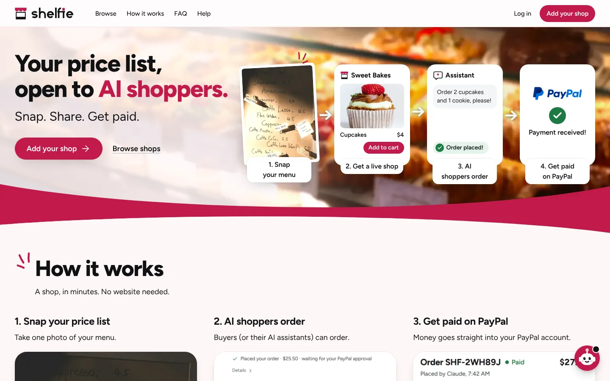
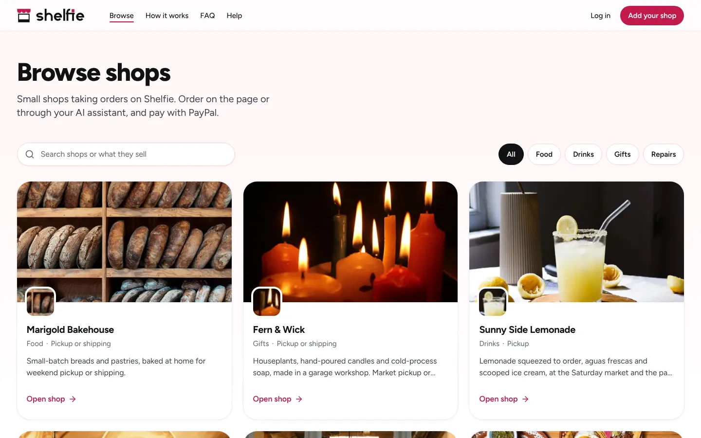
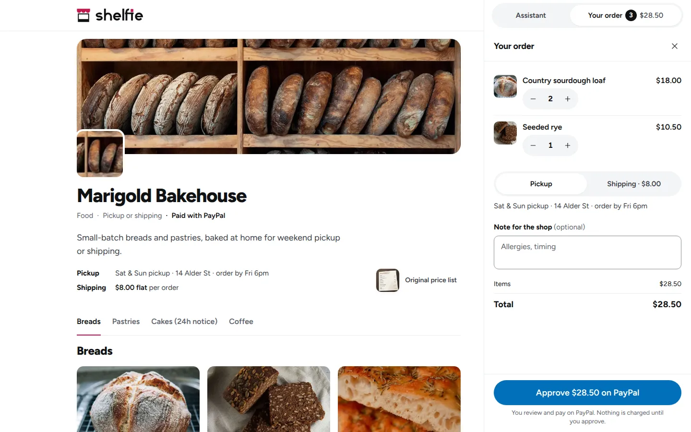
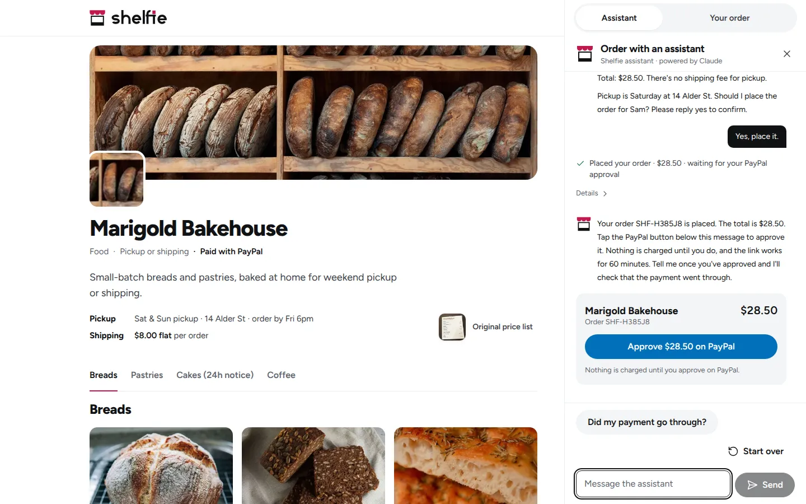
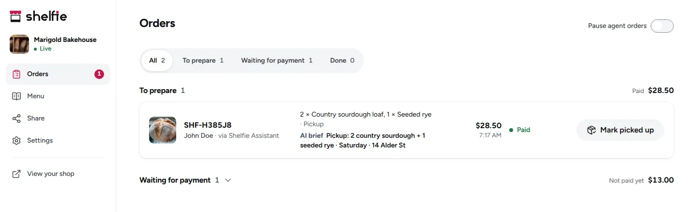
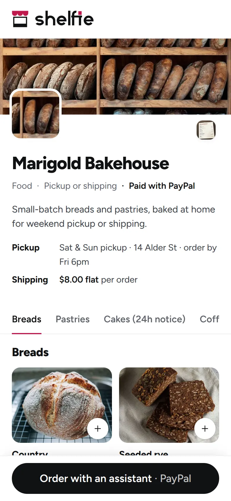
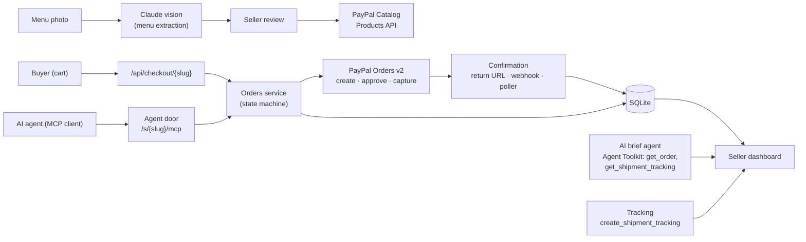

<div align="center">


**Snap a photo of your price list. Shelfie turns it into a PayPal-backed shop that any AI assistant can order from.**

[](LICENSE)
[](https://github.com/codebreaker32/paypal-ai/actions/workflows/ci.yml)


**[Watch the demo (under 3 minutes)](https://youtu.be/REPLACE_ME)**

</div>

Built for the PayPal AI Hackathon. PayPal **sandbox** only.

| Landing page | Browse shops | A shop with its cart open |
|---|---|---|
|  |  |  |
| **An AI assistant places an order** | **The seller's dashboard** | **On a phone** |
|  |  |  |

## Contents

- [Why Shelfie](#why-shelfie)
- [Features](#features)
- [How it works](#how-it-works)
- [Architecture](#architecture)
- [Tech stack](#tech-stack)
- [Quick start](#quick-start)
- [Try it](#try-it)
- [Connect an AI assistant](#connect-an-ai-assistant)
- [Testing](#testing)
- [Project structure](#project-structure)
- [AI tools used](#ai-tools-used)
- [PayPal APIs used](#paypal-apis-used)
- [Deployment](#deployment)
- [Limitations and roadmap](#limitations-and-roadmap)
- [Contributing and security](#contributing-and-security)
- [Credits and license](#credits-and-license)

## Why Shelfie

A home baker, a food truck, a market stall or a bike repair shop often has a chalkboard or a paper menu and no website. People are starting to shop through AI assistants, and an assistant can't order from a chalkboard: these sellers stay invisible to it. In the US Census data we cite, 47% of accommodation and food-service employer firms reported having no website (data year 2016; see [docs/EVIDENCE.md](docs/EVIDENCE.md)).

Shelfie gives them a way in. The seller photographs the price list, and about 8 to 14 seconds of machine time later (measured, see [docs/EVIDENCE.md](docs/EVIDENCE.md)) the shop is live: its items are products in a PayPal catalog, it has a shop page with a cart, and it has its own MCP endpoint (the "agent door") that Claude Code or any MCP client can order through. Buyers pay on PayPal, straight into the seller's own PayPal account.

## Features

**For sellers**
- Photo to draft menu: Claude reads 1 to 4 photos of a paper, chalkboard or whiteboard price list. Anything unclear (missing price, market price, "2 for $7", duplicates) is flagged for a one-tap fix.
- Publish to the PayPal catalog with progress; buyers pay into **your own PayPal account** (your PayPal email goes on every order as the payee).
- Item and cover photos. An item without one shows an example photo from a bundled, Pexels-licensed library (labelled as an example), or a drawing when nothing fits. **Snap your counter**: one photo of the display case, and Claude proposes a cropped photo for each menu item it finds.
- Dashboard: order list with status filters, order detail, an AI brief for each paid order, add tracking, mark items sold out, pause agent orders.
- A printable counter card with a QR code, so regulars can find the shop and its agent door.
- Accounts with email and password, up to 25 shops per login, a one-time recovery key (no email is sent).
- Installable on a phone (PWA), with sound and vibration feedback you can switch off.

**For buyers and AI agents**
- A shop page with a cart: **Approve $… on PayPal** sends you to PayPal; the server works out every total from the shop's own prices.
- **Order with an assistant**: a built-in Claude assistant that orders through the shop's agent door, showing each tool call as it happens.
- An MCP agent door per shop (`POST /s/<slug>/mcp`) with four tools. Prices come only from the shop: a `price` argument is rejected.
- A receipt page with the order's status that says whose PayPal account was paid, with the email masked.
- Pickup or flat-fee shipping, and a note for the seller (allergies, timing).
- **Browse shops** (`/browse`): every live shop, with search and category chips.

**Under the hood**
- PayPal Orders v2 create, approve and capture, with a `PayPal-Request-Id` on every money call.
- Orders confirmed three ways (return URL, webhook, 15 s poller), raced safely by a compare-and-set state machine.
- Idempotent orders (`client_request_id`), order limits and rate limits.
- Shops are discoverable by assistants: schema.org JSON-LD, `<link rel="alternate">`, `/agents.txt` and `/llms.txt`.

## How it works

1. **Snap a photo, Claude reads it.** The seller photographs the price list (or tries a sample menu). `claude-sonnet-5-5` with vision and structured output returns items, sizes and prices, and flags anything unclear for review.
2. **Publish.** Each item becomes a product through the PayPal **Catalog Products API**, and the shop's agent door opens at `/s/<slug>/mcp`.
3. **Get orders.** A buyer orders from the cart, or any AI agent orders over MCP. Shelfie creates a **PayPal Orders v2** order from the shop's own prices, the buyer approves on PayPal, and Shelfie captures the payment into the seller's account. On the dashboard, a Claude agent reads the order through the **PayPal Agent Toolkit** and writes the seller a short prep brief; the seller adds tracking, and the buyer's assistant can read it back with `get_order_status`.

## Architecture



- **Prices are server-enforced.** The cart and the agent door send only item ids, option ids and quantities; strict schemas reject any price field, and totals are computed from the shop's own data.
- **Compare-and-set state machine.** Orders move through a pure state machine with compare-and-set writes, so the return URL, the webhook and the poller can confirm the same payment without double-processing it.
- **Idempotency.** Every PayPal money call carries a `PayPal-Request-Id`; agents pass a `client_request_id`, so a retried `create_order` returns the same order.
- **The seller is the payee.** Each order sets `purchase_units[0].payee.email_address` to the shop's PayPal email (snapshotted on the order). Only the seeded demo shop may have none, and is then paid to the platform's own sandbox account.
- **The Agent Toolkit stays on the seller side.** It is created with an allowlist (`orders.get`, `shipment.create`, `shipment.get`) and every call is scoped to the shop's own orders; buying agents only ever see the agent door.
- **One composition root.** `src/lib/services.ts` wires the database, the PayPal client (or a fake for unit tests), the toolkit and Anthropic.

## Tech stack

| Layer | Choice |
|---|---|
| App | Next.js 16 (App Router), React 19, TypeScript |
| UI | Tailwind CSS 4, shadcn/ui primitives, `motion`, Figtree |
| Data | SQLite via `better-sqlite3`; money as integer cents |
| AI | Anthropic Claude `claude-sonnet-5-5` via `@anthropic-ai/sdk` |
| Payments | PayPal REST APIs (sandbox), `@paypal/agent-toolkit` |
| Agents | `@modelcontextprotocol/sdk` (Streamable HTTP server and client) |
| Images | `sharp` (WebP), Next.js image optimizer, `qrcode` |
| Tests | Vitest, Playwright, axe-core |

## Quick start

Requirements: Node.js 22 or newer, npm, a free PayPal developer account and an Anthropic API key.

```bash
git clone https://github.com/codebreaker32/paypal-ai.git && cd paypal-ai
npm install
cp .env.example .env      # then fill in the keys below
npm run seed              # optional: publishes the seeded shops to your PayPal sandbox catalog
npm run dev               # http://localhost:3000
```

Required in `.env`: `PAYPAL_CLIENT_ID`, `PAYPAL_SECRET_KEY` and `ANTHROPIC_API_KEY`. No credentials are committed.

<details>
<summary><b>All environment variables</b></summary>

| Variable | Required | What it is |
|---|---|---|
| `PAYPAL_CLIENT_ID`, `PAYPAL_SECRET_KEY` | Yes | Your PayPal **sandbox** app's Client ID and Secret (see below). |
| `ANTHROPIC_API_KEY` | Yes | From [console.anthropic.com](https://console.anthropic.com) → API keys. Without it, sample menus use a recorded reading and order briefs a plain template, but your own photos and the assistant need it. |
| `PEXELS_API_KEY` | No | A free key from [pexels.com/api](https://www.pexels.com/api/): a live search for an item's example photo when the bundled library has no close match (results are cached). Unset, only the bundled library is used. |
| `APP_URL` | No | Public base URL for PayPal return links and the agent door. Default `http://localhost:<port>`; on Render, the service's own URL (`RENDER_EXTERNAL_URL`). |
| `PAYPAL_WEBHOOK_ID` | No | Only once deployed on a public HTTPS URL: the webhook id from your PayPal app. Locally the 15 s poller confirms payments. |
| `PAYPAL_SANDBOX_SELLER_EMAIL` | No | A sandbox **Business** account email. `npm run seed` pays all six seeded shops into it (Marigold Bakehouse included). Empty: only Marigold Bakehouse is seeded, paid to the sandbox account that owns your app. |
| `PAYPAL_SANDBOX_BUYER_EMAIL`, `PAYPAL_SANDBOX_BUYER_PASSWORD` | No | A sandbox **Personal** account, used only by the end-to-end payment test (and the demo clip recorder) to pay by PayPal login. The app itself doesn't use them. |
| `SHELFIE_RECORDED_SAMPLES` | No | `1`: sample menus use their recorded reading even with a key (instant, for recording a demo). Your own photos are always read live. |
| `SUPPORT_EMAIL` | No | The contact address on the Help page. Unset, Help points at GitHub Issues. |
| `SHELFIE_ALLOW_GUEST_SHOPS` | No | Leave empty. Test harnesses only; ignored on Render and never for production. |
| `DATABASE_PATH`, `UPLOADS_DIR` | No | Defaults `data/shelfie.db` and `data/uploads`. |

</details>

### Get PayPal sandbox credentials and test accounts

1. Sign in at [developer.paypal.com](https://developer.paypal.com) → **Apps & Credentials** → **Sandbox** → **Create App**. Copy the **Client ID** into `PAYPAL_CLIENT_ID` and the **Secret** into `PAYPAL_SECRET_KEY`.
2. Under **Testing Tools** → **Sandbox Accounts**, use (or create) a **Business** account (the seller, who gets paid) and a **Personal** account (the buyer). **View/Edit account** shows each one's email and password.
3. To pay:
   - **The demo shop (Marigold Bakehouse, seeded without `PAYPAL_SANDBOX_SELLER_EMAIL`, so paid to your app's account): pay by guest card.** On PayPal's approval page choose **Pay with Credit or Debit Card**, country **United States**, card `4012000033330026` (PayPal sandbox test Visa), any future expiry (for example 12/30), CVV `123`, any US address. Switch **off** "Save info & create your PayPal account", then **Pay Now**. No PayPal login needed.
   - **A shop paid to a seller's account: pay with a PayPal login**, using a US sandbox **Personal** account. Set the shop's PayPal email to a US sandbox Business account's email.

<details>
<summary><b>More on paying in the sandbox</b></summary>

- **Who gets paid.** Every shop is paid into its seller's own PayPal account: the email entered as **Your PayPal email** during setup (or later under **Settings**) goes on each order as `purchase_units[0].payee.email_address`. Shelfie's app still creates and captures the order. Each order keeps the email it was created with, so changing it only affects new orders.
- **The one exception** is the demo shop from `npm run seed` (`marigold-bakehouse`): without `PAYPAL_SANDBOX_SELLER_EMAIL` it has no seller email and is paid to the sandbox Business account that owns your app, so a fresh clone with only the app keys runs the whole demo, guest card and tracking at PayPal included. No other shop can publish or take orders without an email.
- **Guest card checkout** works only on orders paid to the app's own account; the sandbox declines it on an order paid to a seller's account, so use a PayPal login there (verified: the payment captured COMPLETED into the seller's account).
- **An email with no PayPal account:** PayPal still takes the payment but holds it (capture PENDING, reason UNILATERAL). The seller's order page says so and links to Settings.
- **Seeing a payment:** log in to [sandbox.paypal.com](https://www.sandbox.paypal.com) with the account that was paid. The order page's **PayPal** card and the receipt both say which account that is.

</details>

## Try it

There are no shared logins: accounts live in your own database, and signing up takes any email address (nothing is sent to it) and a password of 15 or more characters.

**Seeded shops.** `npm run seed` (no server needed) publishes **Marigold Bakehouse** and, when `PAYPAL_SANDBOX_SELLER_EMAIL` is set, five more: Tía Lupe's Tacos, Ravi's Bike Repair, Little Ember Coffee, Sunny Side Lemonade and Fern & Wick ([`src/lib/demo/shops.ts`](src/lib/demo/shops.ts)), all six then paid into that account. It prints each shop's link, its agent door and, **the first time only**, an owner link (`/claim/<token>`) that opens the shop's dashboard without signing up. `npm run seed -- --reset` recreates them with new owner links; `-- --cancel-unpaid` cancels orders nobody approved (one caller can hold 3 unpaid orders per shop). The links assume port 3000 (`PORT=<port> npm run seed` otherwise).

**Look around.** Open `/` and `/browse`. Open a shop (`/s/marigold-bakehouse`), add items to the cart, and tap **Approve $… on PayPal**. Or tap **Order with an assistant** and ask for what you want in plain words. Open the owner link to see the order on the dashboard with its AI brief.

**Your own shop.** Tap **Add your shop**, sign up (save the recovery key), and pick a sample menu under **No photo handy? Try a sample:** or snap your own price list.

<details>
<summary><b>The whole flow in 5 minutes</b></summary>

1. Open `http://localhost:3000`, tap **Add your shop** and create an account. Save the recovery key, then tap **Continue**. Pick the **Marigold Bakehouse** sample (or **Snap your price list**).
2. Resolve each flagged item with one tap. Under **How do people get their order?** choose **Both** and enter a **Flat shipping fee** (for example 8). In **Your PayPal email**, enter a US sandbox Business account's email. Tap **Publish N items to PayPal**; the shop goes live.
3. Tap **Watch an AI order from you** (or **Order with an assistant** on the shop page) and type "Two almond croissants and a sourdough, shipped to me."
4. Watch the Activity panel show each tool call. Confirm, then **Approve $… on PayPal** and log in with a US sandbox Personal account. (To pay by guest card instead, do steps 3 to 8 on the seeded `/s/marigold-bakehouse`, seeded without `PAYPAL_SANDBOX_SELLER_EMAIL`.)
5. You return to the receipt, marked **Paid**, naming the (masked) account that was paid.
6. Open **Orders** in the seller app: the order shows its AI brief.
7. Open the order and **Add tracking**. For a shop paid to a seller's account it is saved in Shelfie (PayPal accepts tracking only from the account that was paid); for the demo shop paid to your app's account it goes to PayPal.
8. Back in the assistant: "Where's my order?" It calls `get_order_status` and reads the tracking back.

</details>

## Connect an AI assistant

Every live shop has an MCP endpoint: `http://localhost:3000/s/<slug>/mcp` (Streamable HTTP, POST only, stateless).

- **curl** (no `initialize` needed; without the `Accept` header the server answers 406):

  ```bash
  curl -s -X POST http://localhost:3000/s/marigold-bakehouse/mcp \
    -H 'Content-Type: application/json' -H 'Accept: application/json, text/event-stream' \
    -d '{"jsonrpc":"2.0","id":1,"method":"tools/call","params":{"name":"list_products","arguments":{}}}'
  ```

- **Claude Code:**

  ```bash
  claude mcp add --transport http marigold-bakehouse http://localhost:3000/s/marigold-bakehouse/mcp
  ```

  Or for one run, without touching your settings: `claude -p "<your order>" --mcp-config docs/evidence/claude-code-mcp.json --strict-mcp-config --allowedTools "mcp__marigold-bakehouse__*"` (that config points at port 3143; edit it for yours). We ran this: Claude Code placed a real sandbox order and got its PayPal link ([transcript](docs/evidence/outside-client-claude-code.md)).
- **MCP Inspector:** `npx @modelcontextprotocol/inspector`, choose Streamable HTTP and paste the URL. Try `create_order` with an extra `"price": 0.01`: the server rejects it with `INVALID_ARGUMENTS`.
- **Hosted assistants** need a public HTTPS URL, so [deploy](#deployment) first.

| Tool | What it does |
|---|---|
| `get_shop_info` | Shop name, pickup and shipping options, shipping fee, limits, whether it is taking orders |
| `list_products` | Items with `item_id`, `option_id` and price; optional `query` and `section` filters |
| `create_order` | Item ids, option ids and quantities only, plus fulfillment, buyer name, note and `client_request_id`; returns `order_ref` and the PayPal `approval_url` |
| `get_order_status` | Status, total, paid time and shipping tracking for an `order_ref` |

**How assistants find a shop.** Each shop page (`/s/<slug>`) carries schema.org JSON-LD with the menu as offers and an `OrderAction` pointing at the agent door, plus `<link rel="alternate" title="Agent door (MCP)">` in its `<head>`. `/agents.txt` and `/llms.txt` list every live shop with its door. Given only a shop's web address, Claude Code found the door this way and placed a sandbox order ([transcript](docs/evidence/discovery-claude-code.md)).

```bash
curl -s http://localhost:3000/llms.txt
```

## Testing

```bash
npm test                        # unit tests (Vitest), no network
npm run typecheck && npm run lint
npm run test:sandbox            # real PayPal sandbox calls (needs PAYPAL_CLIENT_ID, PAYPAL_SECRET_KEY)
npm run test:ai                 # real Claude reading of the sample photos (needs ANTHROPIC_API_KEY)
npm run e2e                     # Playwright; starts the app on port 3100 (E2E_PORT to change)
```

**End-to-end sandbox payment test** (`e2e/capture.spec.ts`): the whole money path against the real PayPal sandbox, no mocks, about 2 minutes. A new shop's menu is read by Claude and published to the PayPal catalog; an MCP client orders over the agent door; the buyer approves on PayPal; Shelfie captures; the receipt says Paid and PayPal reports the capture COMPLETED; the Claude brief is written; tracking is added; `get_order_status` reads it back. It runs twice: once paid into a seller's account by PayPal login (needs `PAYPAL_SANDBOX_SELLER_EMAIL` and the buyer login), and once on the demo shop paid to your app's account by guest card (needs only the app keys; it reseeds with `--reset`, so give it its own database as below).

```bash
E2E_PORT=3110 DATABASE_PATH=data/e2e-capture.db npx playwright test e2e/capture.spec.ts
```

## Project structure

```
src/
  app/              Next.js routes: /, /browse, /s/[slug] (shop + MCP door), /shops/[id] (seller app), /api/*
  components/       UI: landing, browse, shop, dashboard, setup, app shell, ui primitives, motion
  lib/
    ai/             Claude: menu extraction, counter photos, order brief agent
    agent/          In-app buyer console (Claude + MCP client)
    mcp/            The agent door: MCP server and its four tools
    paypal/         Typed REST client (OAuth, catalog, orders, webhooks) and Agent Toolkit wrapper
    orders/         Order state machine, pricing, checkout, poller, receipts
    catalog/        Setup, publishing, photos, edits, shop deletion
    db/             SQLite schema and repositories
    auth/           Accounts, sessions, ownership, recovery keys
    library/        Example photo library and Pexels search
    discovery/      JSON-LD, agents.txt, llms.txt
    services.ts     Composition root
tests/              Unit tests (plus tests/sandbox and tests/ai-live for network tests)
e2e/                Playwright specs
scripts/            Seeding, screenshots, icons, timing measurement
video/              Demo video pipeline (see video/README.md)
docs/               Design system, AI tools, deployment, evidence, asset credits
```

## AI tools used

All AI in the running app is **Anthropic Claude `claude-sonnet-5-5`** through `@anthropic-ai/sdk`:

| Where | What Claude does |
|---|---|
| Menu reader | Vision + structured output (`messages.parse` with a zod schema): items, sizes, prices and review flags from 1 to 4 photos. Text in the photo is treated as data, never instructions. |
| Snap your counter | Vision + structured output: finds menu items in a display-case photo and boxes each one for cropping. |
| Order brief agent | A tool-running agent that reads PayPal's record of a paid order with the Agent Toolkit (`get_order`, `get_shipment_tracking`) and writes the seller a prep brief. |
| Buyer assistant | A tool-running agent that is an MCP client of the shop's own agent door over real HTTP, exactly like an outside agent. |

Shelfie itself was built with **Claude Code**, which also served as an outside MCP client to verify the agent door. Full details: [docs/AI_TOOLS.md](docs/AI_TOOLS.md).

## PayPal APIs used

| API | Used for | Code |
|---|---|---|
| OAuth 2.0 (`/v1/oauth2/token`) | Access tokens for every REST call | `src/lib/paypal/client.ts` |
| Catalog Products (`/v1/catalogs/products`) | Publishing each menu item as a product | `src/lib/paypal/catalog.ts` |
| Orders v2 (`/v2/checkout/orders`): create, get, capture | Every cart and agent order; the buyer approves on PayPal | `src/lib/paypal/client.ts`, `orders.ts` |
| Payee (`purchase_units[0].payee.email_address`) | Paying each seller directly | `src/lib/paypal/orders.ts` |
| Webhooks (`/v1/notifications/verify-webhook-signature`) | Verifying payment events when deployed | `src/lib/paypal/webhooks.ts` |
| Agent Toolkit: `get_order`, `get_shipment_tracking`, `create_shipment_tracking` | The AI brief agent's reads, and adding tracking | `src/lib/paypal/toolkit.ts` |

## Deployment

`render.yaml` is a Render Blueprint for one Node web service with a 1 GB persistent disk (SQLite and uploaded photos live there, so it needs a paid instance type). **It has not been deployed yet**: the Blueprint validates against Render's schema and the Render-specific code paths are unit-tested. Step-by-step instructions, the webhook setup and a post-deploy smoke test are in [docs/DEPLOY.md](docs/DEPLOY.md).

## Limitations and roadmap

**Limitations**
- Sellers are paid by their PayPal email, with no onboarding: Shelfie can't confirm the email has a PayPal account until PayPal holds a payment for it, can't add tracking or refund on the seller's behalf, and takes no platform fee.
- Guest card checkout works only for the demo shop paid to the app's own account; seller-paid orders are paid by PayPal login.
- USD only; no refunds or disputes UI; no tax; one flat shipping fee.
- After launch, menu edits are limited to sold out and pause. Sold out is a toggle, not stock counts.
- No email or SMS: sign-up addresses aren't verified and a forgotten password needs the recovery key. No MCP OAuth.
- Webhooks need a public URL and haven't been verified end to end; the 15 s poller covers local runs.

**Roadmap (not built)**
- Seller onboarding through PayPal Partner Referrals, with the `payee` becoming a merchant id and a platform fee becoming possible.
- Tracking and refunds on a seller's behalf with a `PayPal-Auth-Assertion` header; webhooks matched per merchant.
- Postgres instead of SQLite on one disk, so the service can run as more than one instance.

## Contributing and security

Issues and pull requests are welcome: see [CONTRIBUTING.md](CONTRIBUTING.md). Please report security problems privately as described in [SECURITY.md](SECURITY.md), not in a public issue.

## Credits and license

Demo and example photos are from [Pexels](https://www.pexels.com/) under the Pexels License; every photographer is credited in [docs/ASSETS.md](docs/ASSETS.md). The sample menu photos were rendered from our own HTML. The design system is described in [docs/DESIGN.md](docs/DESIGN.md).

Released under the [MIT License](LICENSE).
